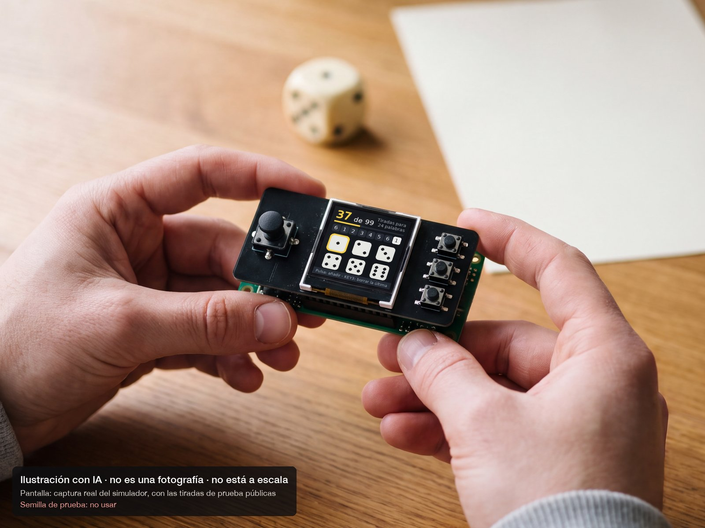
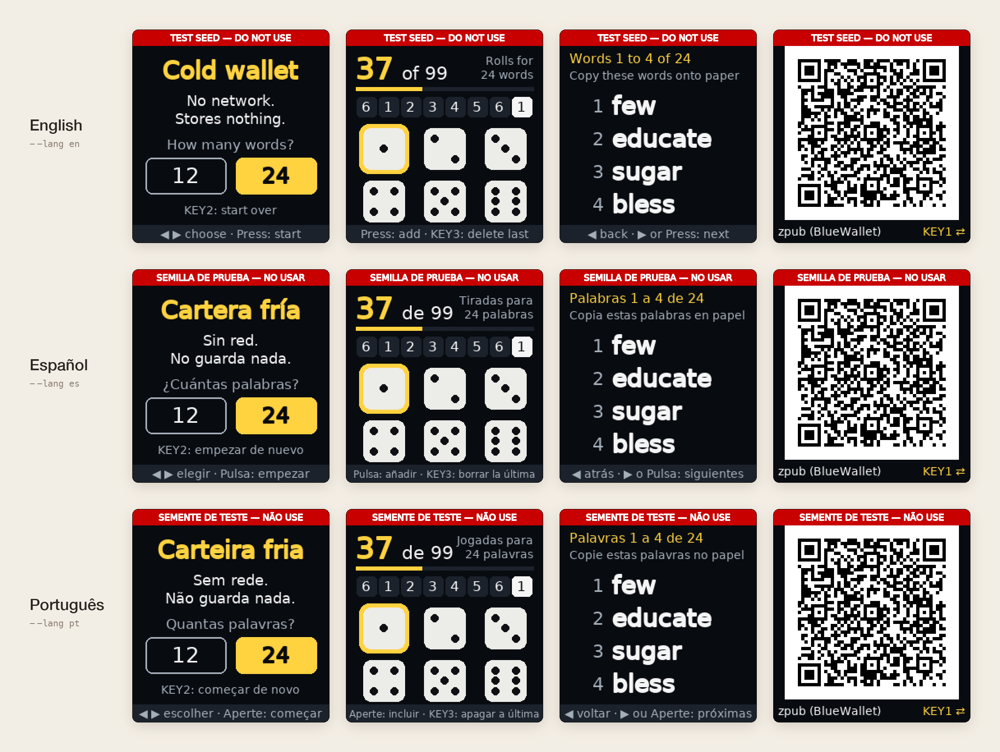

# Cartera fría de dados (prototipo)

> [!WARNING]
> **Es un prototipo: no lo uses para guardar tus ahorros.**
>
> - **Nunca ha funcionado en una Raspberry Pi Zero de verdad.** Los pines de la pantalla están por confirmar y ningún móvil ha
>   leído todavía su QR.
> - **Nadie ajeno al proyecto lo ha revisado.** Solo se ha comprobado en software, con la batería de pruebas.
> - Quien lo monte o lo use lo hace **por su cuenta y riesgo**. El programa se ofrece sin ninguna garantía (ver
>   [LICENSE](LICENSE)).
> - No guardes dinero de verdad en una cartera hecha con él hasta que el código esté revisado y el aparato probado en la placa.



*Ilustración generada con IA de cómo podría verse el prototipo. No es una
fotografía: el prototipo nunca ha funcionado en una Raspberry Pi Zero de
verdad. La zona de la pantalla es una captura real del simulador, hecha con las
tiradas de prueba públicas. No está a escala: la placa real mide 65 × 30 mm y
la pantalla, 1,3 pulgadas.*

English: [README.md](README.md) · Guía paso a paso (en inglés):
https://knowingbitcoin.com/build-your-own-cold-wallet-from-dice/

Cartera fría propia para una Raspberry Pi Zero v1.3 (la que no tiene wifi ni
Bluetooth) con la pantalla Waveshare 1.3" LCD HAT. Sin red y sin memoria: se
enciende, se usa una vez y se apaga.

## Pantallas en tres idiomas

Las pantallas del aparato están en español, inglés y portugués de Brasil. Con
el idioma solo cambia el texto de la pantalla: la frase de recuperación usa
siempre la lista de palabras BIP39 en inglés, los botones hacen lo mismo y la
frase y el QR son idénticos en los tres idiomas; la batería de pruebas lo
comprueba.



El idioma se elige con `--lang es`, `--lang en` o `--lang pt`. Si no se indica,
sale en español.

```bash
.venv/bin/python main.py --sim --lang en
```

En la Raspberry, añade `--lang en` (o `--lang pt`) al final de la línea
`ExecStart` de [`deploy/cartera-fria.service`](deploy/cartera-fria.service)
antes de instalar el servicio (paso 9). Sin él, el aparato sale en español.
Da igual escribirlo en mayúsculas o en minúsculas, y `pt-BR`, `pt_br` o `br`
también valen para el portugués de Brasil. Con cualquier otro valor, el
simulador se para con un error y el aparato sale en español, para que su
pantalla no se quede nunca en negro.

Las 26 pantallas de cada idioma, hechas con las tiradas de prueba y con la
franja de semilla de prueba:
[español](docs/screenshots/es/) · [inglés](docs/screenshots/en/) ·
[portugués de Brasil](docs/screenshots/pt/).

## Qué hace

1. Recoge tus tiradas de dado: 99 para una frase de 24 palabras o 50 para una
   de 12.
2. Te deja revisar las tiradas en grande, cambiar cualquiera sin volver a
   meter las demás y te avisa si no parecen al azar.
3. Calcula la frase BIP39 a partir de las tiradas, te la enseña de cuatro en
   cuatro y después te pregunta **todas** las palabras, una a una, mirando tu
   papel.
4. Calcula la cuenta BIP84 (direcciones `bc1q…`, ruta `m/84'/0'/0'`) **dos
   veces**, con embit y con una segunda implementación que solo usa la
   biblioteca estándar de Python. Si no coinciden, no enseña nada.
5. Enseña un QR con la clave pública de la cuenta para usarla en modo de solo
   lectura en BlueWallet, Nunchuk o Sparrow. KEY1 cambia entre:
   - el **zpub**, para BlueWallet;
   - el **descriptor de dos ramas**
     `wpkh([huella/84h/0h/0h]xpub…/<0;1>/*)#suma`, que lleva cobro y cambio a
     la vez (BIP-389) y es el que mejor entienden Sparrow y Nunchuk.
6. Te pide comparar la primera dirección de cobro (y la huella, si usaste el
   descriptor) con lo que enseña el móvil.

## Qué no hace

- **No firma.** Para gastar hará falta otro aparato o programa que firme con
  la frase (SeedSigner, Coldcard, Jade o Sparrow en un ordenador sin red).
- **No guarda nada.** Ni tiradas, ni frase, ni semilla, ni la clave pública.
  Al apagar, todo desaparece.
- **No usa frase de contraseña** (la palabra 25). El núcleo la admite y la
  normaliza bien (NFKD), pero la interfaz no la pide.
- No tiene red ni la usa: el código de la cartera no importa nada que hable con
  internet, y en la Raspberry comprueba al arrancar, y tras cada botón, que no
  hay ninguna interfaz de red aparte de `lo`. Si la hay, se bloquea.

## Lista de la compra

| Pieza | Notas |
|---|---|
| Raspberry Pi Zero v1.3 (**sin W**) | La v1.3 no tiene radio. No vale la Zero W ni la Zero 2 W. Con los pines ya soldados (o soldarlos), porque la pantalla va pinchada encima. |
| Waveshare 1.3inch LCD HAT | ST7789, 240×240, joystick de 5 direcciones y botones KEY1, KEY2 y KEY3. |
| Tarjeta microSD de 8 a 32 GB | De marca. Se graba una vez y se deja en solo lectura. |
| Batería USB (power bank) y cable micro-USB | Al puerto **PWR** de la Zero, no al de datos. |
| Lector de tarjetas microSD | Para grabar el sistema desde otro ordenador. |
| Dado de casino | Mejor que uno de juego: caras planas y esquinas vivas. |
| Papel y lápiz | Para las tiradas y para la frase. |

## Probar el simulador en el Mac

```bash
cd dice-cold-wallet
.venv/bin/python main.py --sim
```

- Flechas = joystick · Intro = pulsar el joystick · 1, 2, 3 = KEY1, KEY2, KEY3.
- El simulador lleva siempre encima una franja roja, en el idioma de la
  pantalla: **SIMULADOR · SOLO PRUEBAS · NO USAR CON DINERO** en español. Un
  ordenador con red no es una cartera fría. Úsalo solo con las tiradas de
  prueba de abajo.

Pruebas y capturas:

```bash
.venv/bin/pytest -q                   # toda la batería
.venv/bin/python scripts/capturas.py  # regenera docs/capturas/
.venv/bin/python scripts/capturas.py --lang all  # regenera docs/screenshots/en/, es/ y pt/
```

Para montar el entorno desde cero: `python3.11 -m venv .venv` y
`.venv/bin/pip install -r requirements-dev.txt`.

### Tiradas de prueba

Son públicas. Cualquier semilla que salga de ellas es una **SEMILLA DE
PRUEBA — NO USAR**.

- 24 palabras, 99 tiradas (es `"123456" * 16 + "123"`):
  `123456123456123456123456123456123456123456123456123456123456123456123456123456123456123456123456123`
- 12 palabras: las 50 primeras de esa misma cadena.

Resultado esperado con 24 palabras:
`few educate sugar bless boring random strategy waste mutual cargo type hawk
prefer denial scan abstract filter extend dignity balcony dust unusual correct
bubble` · huella `5545de0e` · primera dirección
`bc1qvjc0ndgk8ap8uy495enag3qtcl4lua6nn3uyys`.

Con 12 palabras: `unveil nice picture region tragic fault cream strike tourist
control recipe tourist` · huella `85480bc5` · primera dirección
`bc1q40jg305efx4r2h9nmp7zr25supg58vpzcgx54e`.

## Cómo se convierte el dado en la frase

Es el mismo método que SeedSigner y Coldcard:

1. Las tiradas se escriben como texto, una cifra por tirada (`"6551…"`).
2. Se calcula el SHA-256 de ese texto.
3. Con 24 palabras se usan los 32 bytes; con 12, los 16 primeros.
4. Esos bytes son la entropía de BIP39, y de ahí sale la frase con la lista
   inglesa oficial.

99 tiradas dan unos 256 bits de entropía (99 × 2,585) y 50 dan unos 129.
**La única fuente de azar de la semilla son tus tiradas**: si no tiras el dado
de verdad cada vez, la semilla se puede adivinar.

Por eso la cartera rechaza las tiradas si una cara sale en más del 30 % de las
veces (la misma regla que Coldcard) o si hay 8 o más iguales seguidas. Con un
dado honrado eso pasa alrededor del 3,4 % de las veces con 50 tiradas y del
0,4 % con 99; si te toca, vuelve a tirar. El control no detecta patrones como
`123456123456…` (las tiradas de prueba lo pasan): tira siempre el dado.

### Comprobarlo contra SeedSigner

Hazlo **solo con tiradas de prueba**, nunca con las de verdad:

1. En un SeedSigner (o en su emulador), elige crear una semilla nueva con
   dados de 24 palabras y mete las 99 tiradas de prueba.
2. Tiene que salir exactamente la frase de prueba de arriba.
3. Haz lo mismo con 12 palabras y las 50 tiradas.

Las pruebas del repositorio ya comparan, con el código de SeedSigner copiado
tal cual, el ejemplo de 99 y de 50 tiradas que trae su documentación.

## Preparar la Raspberry

Todo esto se hace **antes de la primera semilla de verdad**, y es la única vez
que la Raspberry puede ver algo conectado. Los comandos están pensados para
Raspberry Pi OS Lite (Bookworm, Python 3.11); en Trixie, revisa los nombres de
los paquetes.

### 1. Paquetes, en otro ordenador

Descarga y comprueba los paquetes en el Mac:

```bash
mkdir paquetes && cd paquetes
pip download embit==0.8.0 qrcode==8.2 --no-deps -d .
shasum -a 256 *
```

Las huellas tienen que coincidir con las de `requirements.txt`. Copia la
carpeta `paquetes/` y este repositorio a la tarjeta (por ejemplo a
`/opt/cartera`).

La librería criptográfica que embit usa en la Raspberry es un binario
precompilado distinto del que se prueba en el Mac:
`embit/util/prebuilt/libsecp256k1_linux_armv6l.so`, sha256
`dd824bcf6c00f6cb1e1b9db962f4ca981c71d2181633374eb27ac7ca7c1b7f25` (embit
0.8.0). Por eso la cartera rehace todo con la implementación independiente
antes de enseñar el QR.

### 2. Instalación (con la Raspberry sin red)

```bash
sudo apt install python3-venv python3-pil python3-spidev python3-gpiozero \
    python3-lgpio python3-setuptools fonts-dejavu-core
# (los paquetes de apt también hay que llevarlos ya descargados si la Pi no
#  tiene red; o hacer este paso una sola vez, antes de la primera semilla,
#  y quitar después el adaptador)
cd /opt/cartera
python3 -m venv --system-site-packages .venv
.venv/bin/pip install --no-index --find-links /opt/cartera/paquetes \
    --require-hashes --no-build-isolation -r requirements.txt
sudo useradd --system --no-create-home --groups spi,gpio cartera
```

Pasa una vez la batería de pruebas **en la propia Raspberry** (copia también
pytest como paquete): así se prueba el binario armv6l de verdad. Tardará bastante.

### 3. Activar SPI y la pantalla

`sudo raspi-config` → Interface Options → SPI → sí.

### 4. Sin memoria de intercambio (la semilla nunca pasa a la tarjeta)

```bash
sudo dphys-swapfile swapoff
sudo systemctl disable --now dphys-swapfile
sudo apt purge dphys-swapfile
# En Trixie: sudo apt purge rpi-swap systemd-zram-generator
swapon --show   # tiene que salir vacío
```

### 5. Sin volcados de memoria

```bash
echo '* hard core 0' | sudo tee /etc/security/limits.d/nocore.conf
printf 'kernel.core_pattern=|/bin/false\nfs.suid_dumpable=0\n' | \
    sudo tee /etc/sysctl.d/90-nocore.conf
```

Si existe systemd-coredump, en `/etc/systemd/coredump.conf` pon
`Storage=none` y `ProcessSizeMax=0`. El servicio lleva además `LimitCORE=0`.

### 6. Registros solo en memoria

En `/etc/systemd/journald.conf`: `Storage=volatile` (o `none`) y
`ForwardToSyslog=no`. Después `sudo apt purge rsyslog`.

### 7. Sin red

```bash
sudo systemctl disable --now ssh NetworkManager dhcpcd wpa_supplicant \
    avahi-daemon bluetooth ModemManager 2>/dev/null
sudo tee /etc/modprobe.d/sin-red.conf <<'EOF'
blacklist usbnet
blacklist cdc_ether
blacklist rndis_host
blacklist r8152
blacklist asix
blacklist ax88179_178a
blacklist cfg80211
blacklist brcmfmac
blacklist bluetooth
EOF
```

- En `/boot/firmware/config.txt`: **ningún** `dtoverlay=dwc2`; puedes añadir
  `dtoverlay=disable-wifi` y `dtoverlay=disable-bt` (no estorban).
- En `/boot/firmware/cmdline.txt`: **ningún** `modules-load=dwc2,g_ether`.
- No instales `pigpio` ni `pigpiod` (abre un puerto de red).

### 8. Sin consola

- Quita `console=serial0,115200` de `cmdline.txt` y pon `enable_uart=0` en
  `config.txt`.
- `sudo systemctl disable serial-getty@ttyS0 serial-getty@ttyAMA0`.
- Sin inicio de sesión automático en tty1 (`raspi-config` → System Options →
  Boot / Auto Login → consola con contraseña).
- `sudo systemctl disable --now apt-daily.timer apt-daily-upgrade.timer`
  y `sudo apt purge unattended-upgrades`.

### 9. El servicio

```bash
sudo cp deploy/cartera-fria.service /etc/systemd/system/
sudo systemd-analyze verify /etc/systemd/system/cartera-fria.service
sudo systemctl daemon-reload && sudo systemctl enable cartera-fria
```

El servicio no escribe nada en la consola ni en el registro, no puede abrir
conexiones de red y no deja volcados de memoria. Está **sin probar en la
placa**: revísalo con la Pi delante.

### 10. Solo lectura

Al final: `sudo raspi-config` → Performance → Overlay File System → activar y
dejar también la partición de arranque en solo lectura. `/tmp` queda en
memoria.

### 11. Uso

Enciende, haz el recorrido y, al acabar, **quita la corriente** y espera unos
segundos. La memoria se borra al apagar; Python no garantiza borrarla antes.

## Antes de mandar dinero: la prueba de restauración

La pantalla «Compara con tu iPhone» solo comprueba que el QR se leyó bien. Para
saber que **tu papel** recupera esa cartera:

1. Restaura las palabras de tu papel en un segundo monedero independiente y
   sin red (SeedSigner, Coldcard, Jade, o Sparrow en un ordenador arrancado sin
   conexión).
2. Comprueba que la huella y la primera dirección de cobro son las mismas que
   enseñó la cartera y que ve el móvil.
3. Manda primero una cantidad pequeña, y **gástala** firmando con ese segundo
   monedero a partir del papel. Solo después, el resto.

## Límites conocidos

- **No firma**: para gastar necesitas otro aparato o programa (ver arriba).
- **Python no borra la memoria de forma garantizada.** La cartera suelta las
  tiradas y la frase en cuanto dejan de hacer falta, vacía las trazas de error
  y no escribe nada, pero el intérprete puede dejar copias en RAM hasta que la
  reutiliza. Lo único que las borra de verdad es apagar. Por eso no hay swap
  ni volcados de memoria.
- **Los pines están por confirmar** con la ficha de la placa que llegue
  (https://www.waveshare.com/wiki/1.3inch_LCD_HAT). Hoy, en numeración BCM:
  pantalla en SPI0/CE0 con DC = 25, RST = 27 y luz de fondo = 24; joystick
  arriba 6, abajo 19, izquierda 5, derecha 26 y pulsar 13; KEY1 21, KEY2 20 y
  KEY3 16.
- **El QR mide unos 21 mm** en la pantalla de 1,3" (módulos de unos 0,4 mm). Hay
  que probar en la Pi que BlueWallet, Nunchuk y Sparrow lo leen. Si no, falta
  añadir una salida alternativa (zpub en texto o QR animado).
- **La doble pulsación** se filtra por programa (se descarta una segunda
  pulsación del centro, KEY1 o KEY3 antes de 0,35 s). Hay que comprobar en la
  placa que al pulsar el centro del joystick no llega también una dirección.
- El cálculo doble tarda unos 0,1 s en el Mac; en la Pi Zero, previsiblemente
  unos segundos. Está por medir.

## Capturas

Todas con las tiradas de prueba y la franja «SEMILLA DE PRUEBA — NO USAR», en
`docs/capturas/`:

`01-bienvenida` · `02-tiradas-vacio` · `03-tiradas-37` ·
`04-empezar-de-nuevo` · `05-revisar-tiradas` · `06-cambiar-una-tirada` ·
`07-revisar-tiradas-ultima-pagina` · `08-confirmar-tiradas` · `09-aviso` ·
`10-frase-1-a-4` · `11-frase-21-a-24` · `12-examen` · `13-examen-fallado` ·
`14-frase-corregir` · `15-examen-aprobado` · `16-calculando` ·
`17-qr-zpub` · `18-qr-descriptor` · `19-comprobacion` · `20-fin` ·
`21-bienvenida-12` · `22-revisar-tiradas-12` · `23-tiradas-raras` ·
`24-hay-red` · `25-algo-ha-fallado` · `26-no-coinciden`.

Las mismas pantallas en los tres idiomas, con la franja traducida y los nombres
de fichero en inglés (`01-welcome`, `03-rolls-37`…), están en
[`docs/screenshots/`](docs/screenshots/), una carpeta por idioma.

## Estructura

- `coldwallet/core.py`: tiradas → frase → cuenta (embit), control de tiradas y
  examen.
- `crosscheck/independent.py`: segunda implementación, solo con la biblioteca
  estándar. La usan las pruebas y también la cartera, para comprobarse.
- `coldwallet/ui/`: máquina de estados, dibujo de las pantallas y textos de la
  pantalla en los tres idiomas (`i18n.py`).
- `coldwallet/hw.py`: pantalla ST7789 y botones de la Raspberry.
- `sim.py`: simulador en el Mac. `main.py`: punto de entrada.
- `deploy/cartera-fria.service`: servicio de systemd.
- `tests/`: pruebas, con los vectores oficiales de BIP39, BIP32, BIP84, BIP173,
  BIP-380 y los ejemplos de SeedSigner.

## Fallos de seguridad

Si encuentras algo que debilite la semilla, filtre las tiradas, la frase o una
clave, o haga que el aparato enseñe una clave pública equivocada, avísalo en
privado como explica [SECURITY.md](SECURITY.md). Nunca mandes tiradas, palabras
ni claves de verdad.

## Licencia

MIT: ver [LICENSE](LICENSE). El material de terceros (la fuente DejaVu, la lista
de palabras BIP39, los vectores de prueba y un fragmento adaptado de SeedSigner)
está en [THIRD_PARTY_NOTICES.md](THIRD_PARTY_NOTICES.md).
