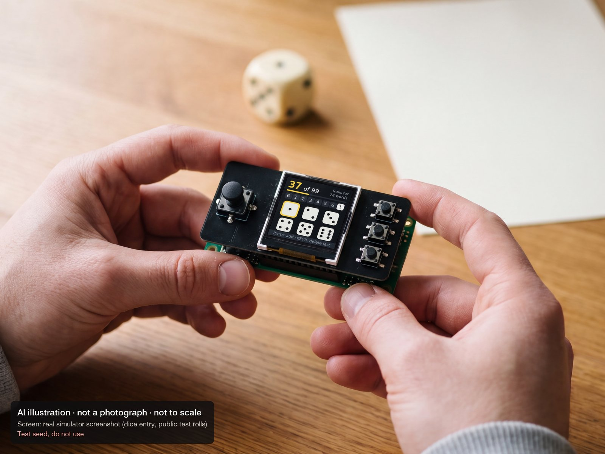
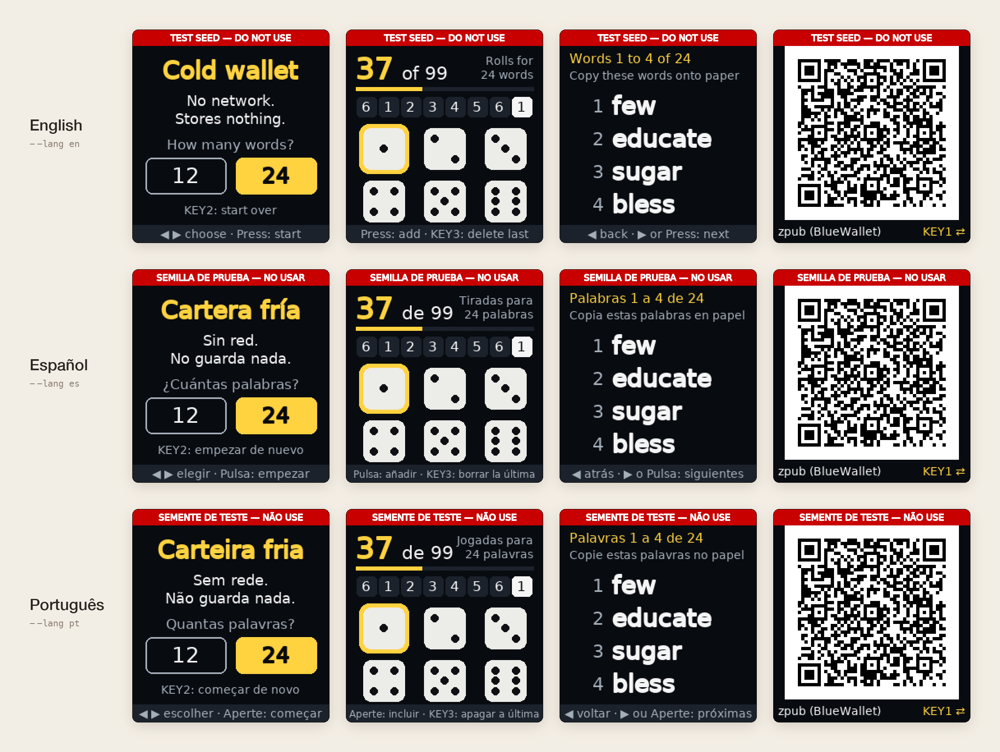

# Dice cold wallet (prototype)

> [!WARNING]
> **This is a prototype. Do not use it for real savings.**
>
> - It has **never run on a real Raspberry Pi Zero**. The display pins are not confirmed and no phone has scanned its QR code.
> - It has had **no external review**. It has only been checked in software (see [Checked and not yet checked](#checked-and-not-yet-checked)).
> - If you build it or use it, **you do so at your own risk**. The software comes with no warranty (see [LICENSE](LICENSE)).
> - Do not put real savings on a wallet made with it until the code has been reviewed and the device has been tested on the hardware.



*AI-generated illustration of how the prototype could look. Not a photograph: the prototype has never run on a real
Raspberry Pi Zero. The screen area is a real simulator screenshot, made with the public test rolls. Not to scale: the real
board is 65 x 30 mm and the screen is 1.3 inches.*

A do-it-yourself cold wallet for a Raspberry Pi Zero v1.3 (the version without Wi-Fi or Bluetooth) with a Waveshare
1.3inch LCD HAT. It has no network and no memory: you switch it on, use it once and switch it off.

It turns your dice rolls into a BIP39 recovery phrase, and shows a QR code of the account's public key so that a wallet app
can watch the wallet without being able to spend from it.

- Guide, step by step: https://knowingbitcoin.com/build-your-own-cold-wallet-from-dice/
- Documentation in Spanish, including the full Raspberry Pi preparation: [README.es.md](README.es.md)
- The screens on the device are in English, Spanish or Brazilian Portuguese (see
  [Screens in three languages](#screens-in-three-languages)). Code comments are in Spanish.

## Screens in three languages

Only the text on the screen changes with the language. The recovery phrase always uses the English BIP39 word list, the
buttons work the same way, and the phrase and the QR code are identical in every language (a test checks this).



Choose the language with `--lang en`, `--lang es` or `--lang pt`. Spanish is the default.

```bash
.venv/bin/python main.py --sim --lang en
```

On the Pi, add `--lang en` (or `--lang pt`) at the end of the `ExecStart` line in
[`deploy/cartera-fria.service`](deploy/cartera-fria.service) before you install the unit. Without it the device shows Spanish.
Upper or lower case both work, and `pt-BR`, `pt_br` or `br` also mean Brazilian Portuguese. With any other value the simulator
stops with an error, and the device shows Spanish instead, so that its screen is never left dark.

All 26 screens in each language, made with the test rolls and carrying the test-seed band:
[English](docs/screenshots/en/) · [Spanish](docs/screenshots/es/) · [Brazilian Portuguese](docs/screenshots/pt/).

## What it does

1. **It takes your dice rolls**: 99 for a 24-word phrase, or 50 for a 12-word phrase. You can review the rolls on screen and
   change any of them without entering the others again.
2. **It rejects rolls that do not look random** and asks you to roll again: one face in more than 30 % of the rolls (the same
   rule as Coldcard), or 8 or more identical rolls in a row (this project's own rule). The code's own simulation of 200,000
   sets of fair rolls rejects about 0.4 % of honest 99-roll sets and about 3.4 % of 50-roll sets. The check does not catch
   patterns such as `123456123456…` (the test rolls below pass it), so roll the die every time.
3. **It turns the rolls into entropy** with the same method as SeedSigner and Coldcard (source code): the SHA-256 of the text of
   the rolls, using all 32 bytes for 24 words and the first 16 bytes for 12 words. 99 rolls carry about 255.9 bits
   (99 × log2(6)); 50 rolls carry about 129.2 bits (50 × log2(6)), which is enough for the 128 bits a 12-word phrase uses.
   **Your rolls are the only source of randomness in the seed.**
4. **It shows the BIP39 phrase** (English word list) four words at a time, then asks you for **every** word, one by one,
   reading from your paper.
5. **It computes the BIP84 account** (`bc1q…` addresses, path `m/84'/0'/0'`) **twice**: once with the
   [embit](https://github.com/diybitcoinhardware/embit) library and once with a second, independent implementation that uses
   only Python's standard library. If the two differ, it shows nothing.
6. **It shows a QR code for watch-only use**. KEY1 switches between:
   - the **zpub**, for BlueWallet;
   - the **two-branch descriptor** `wpkh([fingerprint/84h/0h/0h]xpub…/<0;1>/*)#checksum` (BIP-389), which carries receive and
     change addresses together, for Sparrow and Nunchuk.
7. **It asks you to compare** the first receive address (and the fingerprint, if you used the descriptor) with what the app
   shows.

The last screen tells you to switch the device off: the seed is erased when power is removed. Keep the paper with the rolls as
safely as the phrase, or destroy it.

## What it does not do

- **It does not sign.** To spend, you need another signer that uses the phrase (SeedSigner, Coldcard, Jade, or Sparrow on an
  offline computer).
- **It stores nothing.** No rolls, no phrase, no seed, no public key. Everything is gone at power-off.
- **It has no passphrase (25th word) input.** The core supports one; the interface does not ask for it.
- **It has no network.** The wallet code imports nothing that talks to the internet. On the Pi it checks at start-up and after
  every button press that no network interface other than `lo` exists. If one does, it stops.

## Checked and not yet checked

**Checked in software (16 Nov 2026):**

- 450 automated tests pass.
- Official test vectors: BIP39, BIP32, BIP84 (including the multipath descriptor), BIP173 (address) and the descriptor
  checksum (BIP-380).
- SeedSigner's two published dice examples (24 and 12 words, from its `docs/dice_verification.md`) give the same words,
  fingerprint and addresses.
- The two independent implementations agree.

**Not yet checked:**

- It has never run on a real Raspberry Pi Zero.
- The display pins are not confirmed.
- No phone has scanned its QR code.
- No external review.
- No way to spend is part of it (another signer is needed).

## Compatibility

- **SeedSigner**: the same rolls give the same words. This was checked against SeedSigner's two published examples, not on a
  SeedSigner device.
- **Coldcard**: the same method (SHA-256 of the roll text), read in Coldcard's source code. The results have not been compared
  with a Coldcard.
- **Ian Coleman's BIP39 tool, "Dice" mode**: different results. By default that mode uses the rolls as raw base-6 entropy, with
  no SHA-256. Do not use it to check your phrase.

## Hardware (proposed, not built)

| Part | Notes |
|---|---|
| Raspberry Pi Zero v1.3 | The version **without** Wi-Fi or Bluetooth. The Zero W and the Zero 2 W are not suitable. It needs header pins (soldered), because the display plugs in on top. |
| Waveshare 1.3inch LCD HAT | ST7789, 240×240 pixels, a 5-way joystick and buttons KEY1, KEY2 and KEY3. It sits on top of the Pi. |
| microSD card, 8 to 32 GB | Written once and kept read-only. |
| USB power bank and micro-USB cable | On the Pi's **PWR** port, not the data port. |
| microSD card reader | To write the system from another computer. |
| A die | A casino die is preferred. |
| Paper and pencil | For the rolls and for the phrase. |

The display and button pins in [`coldwallet/hw.py`](coldwallet/hw.py) (BCM numbering) come from Waveshare's documentation
and are not confirmed on a real board.

## Run the tests and the simulator

Tested on macOS with Python 3.11. The simulator needs Tkinter.

```bash
git clone https://github.com/knowingbitcoin/dice-cold-wallet.git
cd dice-cold-wallet
python3.11 -m venv .venv
.venv/bin/pip install -r requirements-dev.txt

.venv/bin/pytest -q                    # the whole test suite (450 tests, about two minutes)
.venv/bin/python main.py --sim         # the simulator (add --lang en or --lang pt to change the language)
.venv/bin/python scripts/capturas.py   # regenerates the screenshots in docs/capturas/
.venv/bin/python scripts/capturas.py --lang all   # regenerates docs/screenshots/en/, es/ and pt/
```

Simulator keys: arrow keys = joystick, Enter = press the joystick, `1`, `2`, `3` = KEY1, KEY2, KEY3.

The simulator always shows a red band on top, in the screen's language: *SIMULATOR · TESTING ONLY · DO NOT USE WITH REAL
FUNDS* with `--lang en`, *SIMULADOR · SOLO PRUEBAS · NO USAR CON DINERO* by default. A computer with a network is not a cold
wallet. Use the simulator only with the test rolls below.

### Test rolls

> **TEST SEED — DO NOT USE.** These rolls are public. Any seed made from them is a test seed: anyone can rebuild it, and
> anything sent to it can be taken.

- 24 words, 99 rolls (`"123456" * 16 + "123"`):
  `123456123456123456123456123456123456123456123456123456123456123456123456123456123456123456123456123`
- 12 words: the first 50 rolls of the same string.

Expected result with 24 words (TEST SEED — DO NOT USE): `few educate sugar bless boring random strategy waste mutual cargo
type hawk prefer denial scan abstract filter extend dignity balcony dust unusual correct bubble` · fingerprint `5545de0e` ·
first receive address `bc1qvjc0ndgk8ap8uy495enag3qtcl4lua6nn3uyys`.

Expected result with 12 words (TEST SEED — DO NOT USE): `unveil nice picture region tragic fault cream strike tourist control
recipe tourist` · fingerprint `85480bc5` · first receive address `bc1q40jg305efx4r2h9nmp7zr25supg58vpzcgx54e`.

The screenshots in [`docs/capturas/`](docs/capturas/) (Spanish) and [`docs/screenshots/`](docs/screenshots/) (one folder per
language) are made from these rolls. Each one carries the test-seed band in its language (*TEST SEED — DO NOT USE*,
*SEMILLA DE PRUEBA — NO USAR*, *SEMENTE DE TESTE — NÃO USE*), and their QR codes encode only the test account.

## Security notes

- **The paper with the rolls is as sensitive as the phrase.** Anyone with the rolls can rebuild the wallet.
- **The network check.** On the Pi, the program looks for network interfaces at start-up and after every button press. If it
  finds any interface other than `lo`, it stops and asks you to disconnect the adapter and restart. The systemd service also
  blocks IP sockets (`RestrictAddressFamilies=AF_UNIX`, `IPAddressDeny=any`).
- **Python does not guarantee that memory is wiped.** The program drops the rolls and the phrase as soon as it no longer needs
  them, clears error traces and writes nothing, but the interpreter can leave copies in RAM. Only power-off clears them. That
  is why the preparation turns off swap and core dumps and keeps logs in memory.
- **The cryptographic library on the Pi is a different binary.** On the Pi, embit uses its prebuilt
  `libsecp256k1_linux_armv6l.so` (embit 0.8.0, sha256
  `dd824bcf6c00f6cb1e1b9db962f4ca981c71d2181633374eb27ac7ca7c1b7f25`), not the one tested on the Mac. This is one reason the
  wallet recomputes everything with the independent implementation before it shows the QR code. Run the test suite on the Pi
  itself once.
- **Pinned dependencies.** `requirements.txt` pins embit and qrcode by version and hash, for an offline install with
  `pip install --no-index --require-hashes`.
- **The comparison screen only checks that the QR code was read correctly.** It does not prove that your paper restores the
  wallet. Before any real funds (and only after review and hardware testing): restore the words from your paper on a second,
  independent, offline signer; check that the fingerprint and the first receive address match; send a small amount and spend
  it by signing with that second signer. Only then the rest.

## Preparing the Raspberry Pi (untested)

The full steps are in Spanish in [README.es.md](README.es.md) ("Preparar la Raspberry"). None of them has been run on a real
board yet. In short, for Raspberry Pi OS Lite (Bookworm, Python 3.11):

- download and check the packages on another computer, then install them offline with pinned hashes;
- enable SPI for the display;
- no swap, no core dumps, logs in memory only;
- no network services, network and Bluetooth kernel modules blacklisted, no USB gadget networking;
- no serial console, no automatic login, no automatic updates;
- the systemd unit in [`deploy/cartera-fria.service`](deploy/cartera-fria.service) (also untested on the board);
- finally, the read-only overlay file system.

## Project layout

- `coldwallet/core.py`: rolls → phrase → account (embit), the roll check and the word quiz.
- `crosscheck/independent.py`: the second implementation, standard library only. The tests use it, and so does the wallet, to
  check itself.
- `coldwallet/ui/`: the state machine, the drawing of the screens and the screen text in three languages (`i18n.py`).
- `coldwallet/hw.py`: the ST7789 display and the buttons on the Pi.
- `sim.py`: the desktop simulator. `main.py`: the entry point (`--sim` or `--hw`, and `--lang`).
- `deploy/cartera-fria.service`: the systemd unit.
- `tests/`: the tests, with the official BIP39, BIP32, BIP84, BIP173 and BIP-380 vectors and SeedSigner's examples.

## Reporting a problem

Security issues: please report them privately, as described in [SECURITY.md](SECURITY.md). Never include real rolls, words or
keys in a report.

## License

MIT, see [LICENSE](LICENSE). Third-party material (the DejaVu font, the BIP39 word list, test vectors and a short snippet
adapted from SeedSigner) is listed in [THIRD_PARTY_NOTICES.md](THIRD_PARTY_NOTICES.md).
